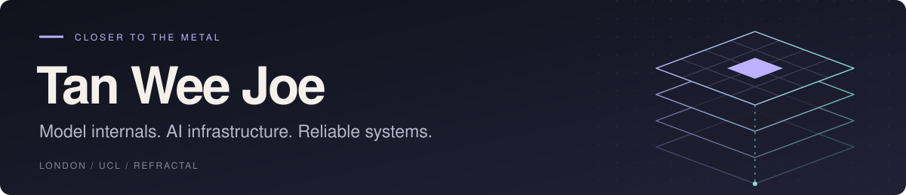

  <b>Software Engineer @ Refractal · Computer Science @ UCL</b> 
  <a href="https://tanweejoe.com">Website</a> ·
  <a href="https://www.linkedin.com/in/tanweejoe">LinkedIn</a> ·
  <a href="https://huggingface.co/w3joe">Hugging Face</a> ·
  <a href="mailto:tanweejoe@gmail.com">Email</a>

I build AI systems from model internals to production infrastructure. My work spans agent security, multi-agent coordination, evaluation pipelines, and the interfaces that make these systems usable. I'm especially interested in mechanistic interpretability, reinforcement learning, world models, and alignment.

## What I build

| Area | Technical focus |
| :--- | :--- |
| **AI security & interpretability** | Prompt-injection detection, residual-stream analysis, activation steering, red teaming, runtime policy controls |
| **Agents & evaluation** | Stateful tool-calling workflows, LangGraph orchestration, multi-agent coordination, browser automation, behavioural evaluation |
| **Systems & product** | Python APIs, React / TypeScript interfaces, event streams, ETL, observability, SDK integrations, containerised deployments |

**Tools I work with:** Python · TypeScript · React · Next.js · FastAPI · LangGraph · Playwright · PyTorch · SQL · Docker

## Currently building

**[Refractal](https://refractal-ai.com)** — AI security infrastructure: APIs and SDK integrations, runtime policy controls, agent evaluation, and auditable evidence pipelines, with Python services and React interfaces.

**[Avenir-UX](https://github.com/Onflow-AI/Avenir-UX)** — Research on multimodal agents that simulate human web interaction to evaluate usability. Combines GUI grounding, persona-driven browser tasks, and structured UX metrics. Built at UCL Nexus Labs. **[Read the paper ↗](https://arxiv.org/abs/2604.09581)**

## Built at hackathons & competitions

### [ReadMyMind](https://github.com/w3joe/readmymind)

**🥇 1st place · Cursor Cybersecurity Hackathon**

Detecting jailbreaks and prompt injections inside a model, then steering generation toward a policy-aligned refusal.

- Layer-by-layer Jacobian Lens readouts from an abliterated Qwen3-8B, paired with refusal-vector steering in a live support-agent demo.
- A 500-case evaluation suite measures detection quality, attack success before and after steering, and inference overhead.

`Python` `PyTorch` `Qwen3-8B` `FastAPI` `Modal` `React` `SSE`

### Sentinel

**🥇 Environment Track · NVIDIA GTC Hack for Impact → Won a Dell GB10**

Decentralised agents negotiating satellite collision avoidance to reduce the risk of debris cascades.

- Dual-path risk classification combines rule-based thresholds with XGBoost, taking the more conservative risk estimate.
- Real-time features from CelesTrak conjunction data and NOAA space weather feeds inform agent negotiations.

`Python` `XGBoost` `FastAPI` `Nemotron-30B`

### [Sentrix](https://github.com/w3joe/sentrix)

**🥇 1st place · AIEngine UCL BUILD AI Festival → Won a trip to NVIDIA GTC 2026** 
**🏆 Winner · Stanford ASES London → Won a trip to Stanford ASES**

An agentic police force for monitoring AI agents and investigating unsafe behaviour.

- LangGraph patrol agents use pheromone-based attention and quorum voting to escalate suspicious activity into a forensic investigation workflow.
- An ETL layer brings agent messages, emails, PRs, and documents into SQLite, with NetworkX for behavioural graph analysis.

`Python` `LangGraph` `SQLite` `NetworkX` `FastAPI` `Next.js` `SSE`

### [Onflow](https://github.com/Onflow-AI/Avenir-UX)

**🥇 1st place · Bloomsbury Startup Academy Demo Day** 
**🥈 2nd place · Gemini 3 London Hackathon**

Multimodal agents that simulate real users and turn their navigation into actionable UI/UX feedback.

- LangChain agents and Playwright drive browser simulations and visualise agent navigation.
- GitHub API and Gemini CLI connect the feedback loop to generated code fixes; the research continues through [Avenir-UX](https://arxiv.org/abs/2604.09581).

`Next.js` `LangChain` `Playwright` `GitHub API` `Gemini CLI`

---

Interested in AI security, interpretability, or agent systems? [Let's talk.](mailto:tanweejoe@gmail.com)
