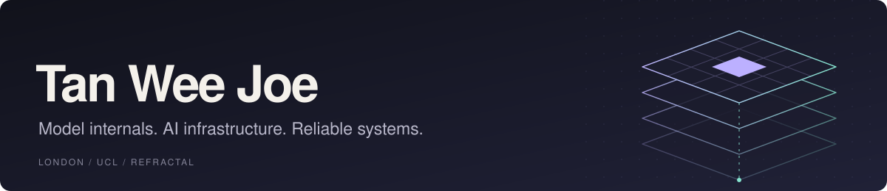

  <b>Software Engineer @ Refractal · Computer Science @ UCL</b>

I'm interested in what happens underneath an AI application: how models compute, how inference runs, and how to make the surrounding systems reliable. I work across model internals, AI infrastructure, and agent security.

**Open-source contributor** to [OpenSRE](https://github.com/Tracer-Cloud/opensre) and [PostHog](https://github.com/PostHog/posthog).

### Technical focus

**Model internals** — Residual-stream analysis, activation hooks, refusal-vector steering, and mechanistic interpretability.

**AI infrastructure** — GPU-backed model serving, streaming APIs, evaluation pipelines, observability, SDK integrations, and containerised services.

**Agent systems** — Stateful execution, tool orchestration, multi-agent coordination, runtime policy enforcement, and adversarial testing.

Python · PyTorch · FastAPI · Modal · Docker · SQL · LangGraph · TypeScript · React

### Building & research

**[Refractal](https://refractal-ai.com)** — Building infrastructure for securing AI agents: runtime controls, evaluation, SDK integrations, and auditable execution.

**[Hypercast 4D](https://github.com/w3joe/hypercast)** · *Research in progress* 
Exploring hypercomplex neural networks for multivariate time-series forecasting: implementing quaternion and related algebraic layers in PyTorch, and studying their behaviour against real-valued baselines.

**[Avenir-UX](https://github.com/Onflow-AI/Avenir-UX)** — Researching multimodal agents for simulated human web interaction and automated usability evaluation at UCL Nexus Labs. [Pre-print ↗](https://arxiv.org/abs/2604.09581)

### Hackathon wins

**[ReadMyMind](https://github.com/w3joe/readmymind)** — Detects prompt injections in a model's residual stream and steers generation toward refusal. 
🥇 1st · Cursor Cybersecurity Hackathon

**Sentinel** — Decentralised agents negotiate satellite collision avoidance using live orbital data and ML risk classification. 
🥇 Environment Track · NVIDIA GTC Hack for Impact · Dell GB10 prize

**[Sentrix](https://github.com/w3joe/sentrix)** — A multi-agent surveillance and forensics system for detecting and investigating unsafe agent behaviour. 
🥇 1st · AIEngine UCL BUILD AI Festival · NVIDIA GTC 2026 trip 
🏆 Winner · Stanford ASES London · Stanford ASES trip

**[Onflow](https://github.com/Onflow-AI/Avenir-UX)** — Multimodal browser agents simulate real users and turn their navigation into UI/UX feedback. 
🥇 1st · Bloomsbury Startup Academy Demo Day 
🥈 2nd · Gemini 3 London Hackathon

---

Exploring mechanistic interpretability, reinforcement learning, world models, and alignment. Always up for a conversation about the systems behind AI.
